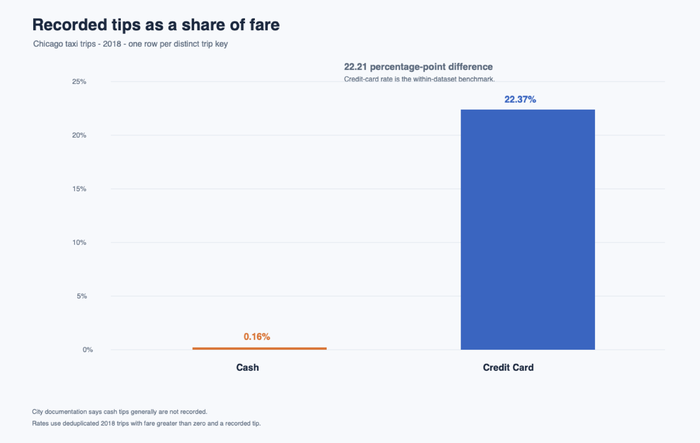

# Finding: Cash tips are under-recorded

## The gap

For 2018 trips with a positive fare and a recorded tip, the deduplicated BigQuery data show cash tips equal to **0.1605% of cash fares**. Credit-card tips equal **22.3715% of credit-card fares**. The cash rate is **22.2110 percentage points lower**.

One analysis row represents one distinct `unique_key` trip. The raw 2018 table had 32,651,674 rows but 20,687,760 distinct keys. Repeated keys had no differing values across trip start, payment type, fare, or tips, so the analysis keeps one record per key. The City of Chicago says cash tips generally are not recorded and that not all trips are reported. [City of Chicago dataset notes](https://data.cityofchicago.org/Transportation/Taxi-Trips-2013-2023-/wrvz-psew)

## The benchmark

Credit-card trips in the same year are the benchmark. They are peer trips in the same dataset, and the City’s documentation says cash tips generally are not recorded. This comparison shows how different recorded tip amounts are when the fare is paid by cash versus card. It does not prove that cash riders actually tip at the card rate.

The 2018 comparison avoids using 2019 as a year-over-year benchmark. The monthly results show only 11 October 2019 records and no November or December records; the City also documents significant changes in July 2019. [City of Chicago 2019 change note](https://data.cityofchicago.org/Transportation/Taxi-Trips-2017/jeij-fq8w)

## Estimated value

The clean 2018 cash-trip fares total **$125,091,981.14**, with **$200,737.49** in recorded tips. Credit-card trips have a tip-to-fare rate of **22.3715%**.

`($34,991,372.78 ÷ $156,410,526.65) × $125,091,981.14 − $200,737.49 = $27,784,208.52`

If cash trips had the same tip-to-fare rate as credit-card trips, about **$27.78 million** in additional cash tips might be unrecorded. This is a proxy estimate, not observed cash income or a confirmed loss. The calculation uses the deduplicated results in [query 09](sql/09_cleaned_tip_rates.sql); the full result table and cleaning rules are in [sql/README.md](sql/README.md).

## Chart

